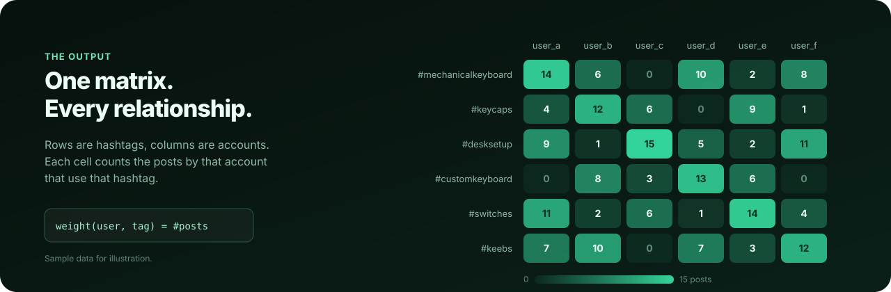
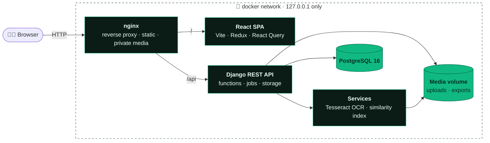

<p align="center">
  
</p>

<p align="center">
  <a href="https://github.com/ViDem02/DataGatherer/actions/workflows/images.yml"></a>
  
  
  
  
</p>

<p align="center">
  <a href="#-quick-start"><b>Quick start</b></a> ·
  <a href="#-how-it-works"><b>How it works</b></a> ·
  <a href="#-architecture"><b>Architecture</b></a> ·
  <a href="#-security"><b>Security</b></a> ·
  <a href="#-for-developers"><b>Developers</b></a> ·
  <a href="docs/industrial_report.pdf"><b>Technical assessment (PDF)</b></a>
</p>

---

**DataGatherer** turns a pile of post screenshots into a clean, queryable dataset. You draw a box around the
account name and the hashtags, OCR reads them, you confirm, and the app builds a **user × hashtag matrix**: how
many times each account used each tag, ready for a spreadsheet, Python/R or network analysis.

It is semi-automatic on purpose: the machine does the tedious reading, a human keeps the final say on accuracy.

<p align="center">
  
</p>
<p align="center"><sub>Figures are estimates from <a href="stats.md">stats.md</a>, not timed measurements, and exclude the human verification step.</sub></p>

## ✨ Highlights

<table>
<tr>
<td width="50%" valign="top">

**🖼️ Batch upload with duplicate detection**<br>
Drop screenshots in bulk; perceptual hashing flags near-identical images so the same post is not counted twice.

**✂️ Crop once, reuse everywhere**<br>
Save a default crop per project and apply it to every image in one go.

**🔎 OCR that knows usernames**<br>
Tesseract with dedicated preprocessing for account names, where similar letters are easy to confuse.

</td>
<td width="50%" valign="top">

**⌨️ Keyboard-driven verification**<br>
Hotkeys for every step, so reviewing hundreds of images stays fast.

**📊 Streamed matrix export**<br>
The user × hashtag CSV is built in three database queries, whatever its size.

**🔐 Private by default**<br>
Runs on your machine only; each user sees only their own projects and images.

</td>
</tr>
</table>

## 🔄 How it works

<p align="center">
  
</p>

<p align="center">
  
</p>

The export is a standard CSV: **rows are hashtags, columns are accounts, each cell is the number of posts** by that
account containing that hashtag. Accounts can be given a readable alias, shown in the column header next to the
original name.

## 🚀 Quick start

> **No technical knowledge needed.** All you need is [Docker Desktop](https://www.docker.com/products/docker-desktop/): install it and open it once.

**1. Download** — on GitHub press **Code → Download ZIP** and unzip it (or `git clone` it).

**2. Start** — double-click the launcher for your system:

|  |  |  |
|:---:|:---:|:---:|
| `start.command`<br><sub>first time: right-click → <i>Open</i>, then confirm</sub> | `start.bat` | `./start.sh` |

**3. Wait** — the first start downloads about 800 MB (a few minutes); later starts take seconds. When it is ready,
the app opens in your browser and the window shows the **administrator username and password**. Keep them: they
are also saved in `.env.docker`.

**Stop** with `stop.command` (Mac), `stop.bat` (Windows) or `./stop.sh`. Your projects and images are kept, also
across restarts.

**Add people** from the admin page shown at the end of the start (e.g. `http://127.0.0.1:8080/api/a/admin/`): log in
as administrator and create users.

> [!WARNING]
> Never delete DataGatherer's Docker **volumes** (for example with `docker compose down -v`): they hold the
> database and the uploaded images.

<details>
<summary><b>If something goes wrong</b></summary>
<br>

The start window says what to do when Docker is not installed, not running, or the port is in use. If it says
DataGatherer did not start, send the messages shown above it to whoever maintains the app.

</details>

<details>
<summary><b>What the start script does</b></summary>
<br>

- Checks that Docker is installed and running.
- On the first start, creates `.env.docker` from `.env.docker.example` with new random passwords, and picks a free
  port (8080, or the next free one) saved as `APP_PORT`.
- Downloads the ready-made images published by CI on the GitHub Container Registry
  (`ghcr.io/videm02/datagatherer-backend` and `-nginx`, for Intel/AMD and ARM) and starts them. If the download is
  not possible, it builds them locally instead (10 to 20 minutes). Each start also pulls updates, if any.
- Waits until the app answers, then opens it in the browser.

</details>

## 🏗️ Architecture



| Layer | Technology |
|---|---|
| **Frontend** | React 18, Vite, Redux Toolkit, TanStack Query, react-image-crop |
| **Backend** | Python, Django 5.2 LTS, Django REST Framework, SimpleJWT, gunicorn |
| **Processing** | Tesseract (`pytesseract`), OpenCV, scikit-image, ImageHash, scikit-learn + Annoy |
| **Data** | PostgreSQL 16; uploaded images on a Docker volume |
| **Edge** | nginx (serves the SPA, proxies the API, serves private files only after Django authorizes them) |
| **Delivery** | Docker Compose; multi-arch images built by GitHub Actions and published on GHCR |

<details>
<summary><b>Project structure</b></summary>
<br>

```text
backend/data_gatherer/
├── data_gatherer/     Django project: settings, auth, admin sites
├── functions_api/     upload, default crop, OCR → network, matrix export
├── job_api/           long-running batch jobs and their progress
├── storage_api/       models & serializers for accounts, hashtags, crops
└── services/          OCR, suggestions, similarity index
frontend/              React SPA (pages, queries, Redux slices)
nginx/                 reverse proxy config + image that builds the SPA
docs/                  technical assessment and README graphics
```

</details>

## 🔐 Security

> [!IMPORTANT]
> DataGatherer is designed for **local use only**. The port is published on `127.0.0.1`: do not change that
> without HTTPS and a firewall.

**What the app enforces**

- 🍪 Login tokens live in `HttpOnly`, `SameSite=Strict` cookies that page scripts cannot read; cookie-authenticated
  writes require the CSRF token; logging out revokes the refresh token.
- 🔒 After 5 failed logins (API or admin) a username is locked for 15 minutes from that IP
  (`LOGIN_FAILURE_LIMIT`, `LOGIN_LOCKOUT_MINUTES`). Unlock early with
  `python manage.py axes_reset_username <username>`.
- 🖼️ Uploaded images are served only to their owner (and staff): nginx sends the file once Django has authorized
  the request.
- 👤 Each user sees and changes only their own projects and data.
- 🏠 The app calls its API on the same address it is opened on, so login cookies never leave that address.

**What you must do**

1. Keep every secret in `.env.docker` unique and random. It is git-ignored: never commit it.
2. If the site is ever served over HTTPS, set `SECURE_COOKIES=1` in `.env.docker`.

## 🛠️ For developers

```bash
# Run your local code instead of the published images
docker compose --env-file .env.docker up -d --build

# Backend straight from the source folder (no rebuild on code changes)
docker compose --env-file .env.docker -f docker-compose.yml -f docker-compose.dev.yml up

# Frontend with hot reload on http://localhost:3000
# (forwards /a/, /b/ and /media/ to the backend on 127.0.0.1:8000)
cd frontend && npm ci && npm start

# Backend tests
docker compose --env-file .env.docker run --rm django python manage.py test
```

- `start.sh` runs the **published images**, not your local code.
- Images are published by [`.github/workflows/images.yml`](.github/workflows/images.yml) on every push to `main`
  (tag `latest`) and every git tag (same name); each also gets a `sha-<commit>` tag. Set `DATAGATHERER_VERSION` to
  pin one.
- The superuser is created on first start from `DJANGO_SUPERUSER_USERNAME` / `DJANGO_SUPERUSER_PASSWORD`.
- Outside Docker, set `DEBUG=1` (development only) or provide a `SECRET_KEY`: the backend refuses to start without
  one when debug is off.
- Index computation is restricted to staff users. For backups, run `pg_dump` on the database container.
- **Extending:** add processing modules under `backend/data_gatherer/services/` and wire them through
  `functions_api` or `job_api`; add frontend calls under `frontend/src/queries/` and consume them in a Redux slice.

**Testing.** Backend unit tests cover the critical data operations and matrix accuracy; they run by hand (CI builds
images but does not run tests yet). The frontend has no automated tests yet.

## 🗺️ Roadmap

- [ ] Run the test suite in CI on every push
- [ ] Frontend tests (Jest + React Testing Library)
- [ ] Scheduled database and image backups with a tested restore
- [ ] Guards against operator errors: duplicate warnings before saving, OCR typo checks
- [ ] Role-based access and audit logging
- [ ] Pluggable storage (S3 for media)
- [ ] More export formats (Parquet) and similarity / clustering visualizations

## 🤝 Contributing

This is primarily a personal / portfolio project, but ideas are welcome:

1. Fork and create a feature branch.
2. Keep changes focused and documented.
3. Open a PR describing the intent and the test impact.

## 📄 License & disclaimer

No license has been chosen yet, so all rights are reserved by default. The repository demonstrates architectural
and data-processing approaches and is **not production-hardened**: see the
[technical assessment](docs/industrial_report.pdf) for readiness, risks and next steps. Use at your own risk.

<p align="center"><sub>Built with Django, React and a lot of screenshots.</sub></p>
